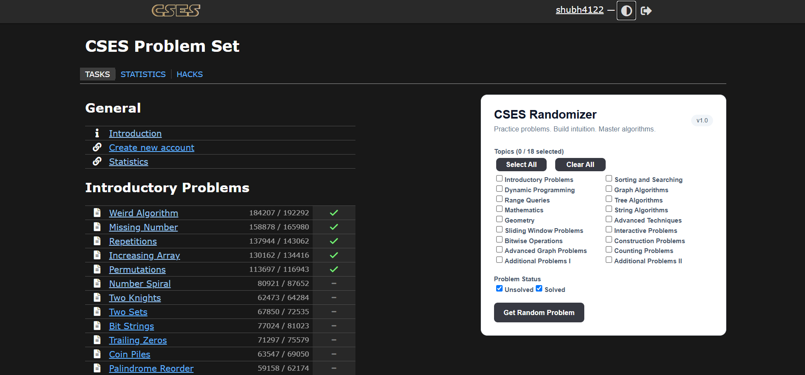

# 🎯 CSES Randomizer

**Stop choosing problems. Start solving them.**

A lightweight browser extension that adds randomized problem selection to the [CSES Problem Set](https://cses.fi/problemset/).

Instead of manually picking problems or knowing their topics beforehand, let the extension choose what you solve next. Customize your practice using topic and problem-status filters.




---

## ✨ Features

- **🎲 Random Problem Selection** — Randomly selects an eligible topic and then a random problem within that topic.
- **📚 Topic Filters** — Choose which topics to include in your practice. Select all or clear all with one click.
- **✅ Status Filters** — Include solved and/or unsolved problems in your selection.
- **⚡ Lightweight Integration** — The interface is injected directly into the CSES Problem Set page.
- **🎯 Focused Practice** — Spend less time deciding what to solve and more time solving.

## 🖥️ How It Works

1. Open the CSES Problem Set.
2. Select the topics you want to practice.
3. Choose the problem statuses to include.
4. Click **Get Random Problem**.
5. The extension randomly picks an eligible topic, then selects a random problem from that topic.
6. Start solving!

> The extension uses the problem information available on the CSES Problem Set page. Sign in to CSES if you want your solved status to be detected.

---

## 🚀 Installation

### Option 1: Install from Source

1. Clone the repository:

   ```bash
   git clone https://github.com/shubh4122/CSES_Randomizer.git
   ```

2. Navigate to the project directory:

   ```bash
   cd CSES_Randomizer
   ```

3. Install dependencies:

   ```bash
   npm install
   ```

4. Start the development build:

   ```bash
   npm run dev
   ```

5. Open Chrome and navigate to:

   ```text
   chrome://extensions
   ```

6. Enable **Developer mode**.

7. Click **Load unpacked**.

8. Select the `.output/chrome-mv3-dev` directory.

9. Open or refresh the [CSES Problem Set](https://cses.fi/problemset/list).

The CSES Randomizer interface should now appear on the page.

### Option 2: Build for Production

Generate a production build:

```bash
npm run build
```

Then:

1. Open `chrome://extensions`.
2. Enable Developer mode.
3. Click **Load unpacked**.
4. Select the `.output/chrome-mv3` directory.

---

## 🛠️ Tech Stack

| Technology            | Purpose                     |
| --------------------- | --------------------------- |
| JavaScript            | Core functionality          |
| React                 | User interface              |
| WXT                   | Browser extension framework |
| CSS                   | Styling                     |


---

## TODOs

- [ ] **Attempted Problems** — Track attempted but unsolved problems.
- [ ] **Favourite Problems** — Bookmark/Star problems for future revision.
- [ ] **Progress Dashboard** — Track solved problems and topic-wise progress.
- [ ] **Persistent Preferences** — Remember selected topics and filters between sessions.
- [ ] **Dark Mode** — Dark theme for the randomizer component

---

## 🤝 Contributing

Contributions, suggestions, and bug reports are welcome.

If you have an idea that could improve the practice experience:

1. Fork the repository.
2. Create a new branch.
3. Make your changes.
4. Submit a pull request.

For bugs or feature suggestions, feel free to open an issue.

